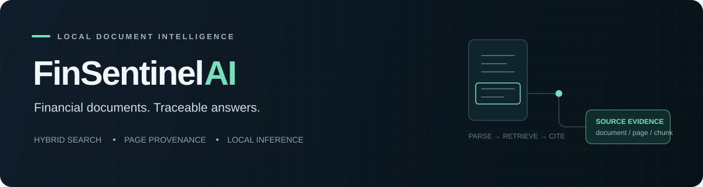
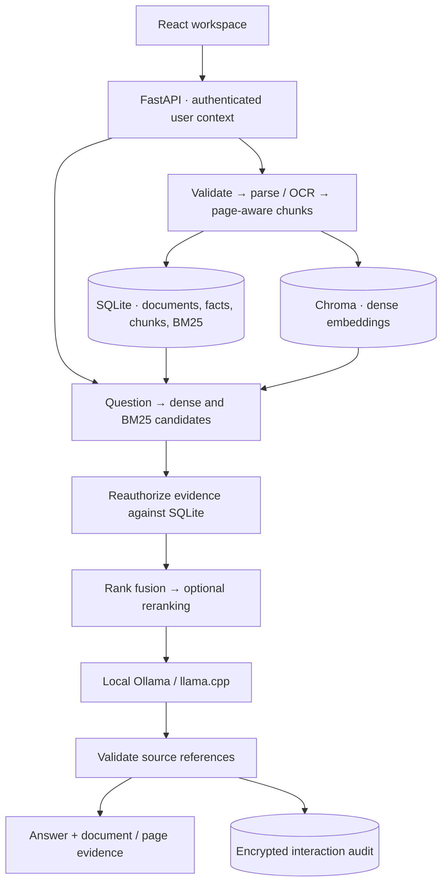

<p align="center">
  
</p>

<p align="center">
  <a href="https://github.com/Lourdhu02/fin-sentinal.ai/actions/workflows/ci.yml"></a>
  
  
  
</p>

# FinSentinelAI

**Search financial documents, ask questions, and trace answers back to their sources—using models on your own machine.**

FinSentinelAI turns PDFs, scans, and text files into a searchable, user-scoped workspace. It combines keyword and semantic retrieval, reranks the evidence, and passes it to a local language model. Answers carry source references; the interface shows the document name, page, and supporting text.

[Quick start](#quick-start) · [Architecture](#architecture) · [CPU & GPU](#cpu--gpu-execution) · [Verification](#verification) · [Roadmap](#roadmap) · [API reference](api.md)

## What you can do

| Capability | What it delivers |
|---|---|
| **Find exact identifiers and related context** | SQLite FTS5/BM25 and Chroma dense search, combined with reciprocal rank fusion and optional cross-encoder reranking. |
| **Inspect the evidence** | Stable document/chunk IDs, page numbers, parser identity, and character offsets accompany retrieved text. |
| **Keep workspaces separate** | Authenticated ownership checks apply to stored evidence, retrieval results, document deletion, and conversation history. |
| **Process financial files** | Native PDF extraction, OCR fallback for scanned pages, and conservative financial-field observations stored as decimal strings. |
| **Recover interrupted ingestion** | Content hashes, deterministic chunk IDs, explicit processing states, and repeatable indexing. |
| **Choose a local runtime** | Ollama and llama.cpp adapters with loopback-only HTTP transport. CPU/GPU placement belongs to the inference runtime. |

The sample corpus covers invoices, salary slips, bank statements, GST returns, purchase orders, and credit/debit notes. The browser accepts PDF, PNG/JPEG, TXT, CSV, JSON, XML, and Markdown uploads.

> **Current scope:** this is a local document-intelligence application under active development. Citation checks verify that references resolve to authorized evidence; they do not yet verify every claim or calculation. Deterministic financial query tools, layout-aware parsing, and measured hardware profiles are on the [roadmap](#roadmap).

## Architecture



SQLite is the source of truth. Chroma supplies a dense index whose hits are checked against the authenticated user's indexed records before generation. Failed or deleting documents cannot contribute evidence. One application instance owns the expensive models and serializes pipeline operations.

## Quick start

The commands below use **PowerShell on Windows**, the locally verified development environment. CI also defines Linux checks. Internet access is needed to install dependencies and provision models; subsequent model loading defaults to local artifacts.

### 1. Install prerequisites

| Requirement | Purpose |
|---|---|
| Python 3.11+ and [uv](https://docs.astral.sh/uv/getting-started/installation/) | Locked Python environment |
| Node.js 22+ and npm | React development server and build |
| [Ollama](https://ollama.com/download) | Default local generation service |
| Tesseract, available on `PATH` | Scanned PDFs and image OCR; optional for native-text PDFs |

### 2. Clone and install

```powershell
git clone https://github.com/Lourdhu02/fin-sentinal.ai.git finsentinel-ai
cd finsentinel-ai
uv sync --locked --python 3.11 --extra local
Copy-Item .env.example .env
```

### 3. Provision the models once

With Ollama running, download the [configured baseline generator](https://ollama.com/library/mistral:7b-instruct-q4_K_M):

```powershell
ollama pull mistral:7b-instruct-q4_K_M
```

Download the embedding and reranking models into the local model cache:

```powershell
$env:HF_HUB_OFFLINE = "0"
uv run --no-sync python -c "from sentence_transformers import SentenceTransformer, CrossEncoder; SentenceTransformer('sentence-transformers/all-MiniLM-L6-v2'); CrossEncoder('cross-encoder/ms-marco-MiniLM-L-6-v2')"
$env:HF_HUB_OFFLINE = "1"
```

Model files are separate from `uv.lock`. For controlled deployments, pin their upstream revisions and record artifact hashes. Missing embeddings fail explicitly; an unavailable optional reranker leaves first-stage ranking active.

### 4. Start the backend

```powershell
uv run --no-sync uvicorn api.main:app --host 127.0.0.1 --port 8000 --env-file .env
```

The API is available at **http://127.0.0.1:8000/docs**. Development mode allows registration and generates persistent random secrets under `runtime/`. To create an admin instead, run `uv run --no-sync python -m cli.bootstrap` from another terminal; it prompts for a password and never overwrites an existing account.

### 5. Start the frontend

In a second terminal, from the repository root:

```powershell
cd frontend
npm ci
npm run dev
```

Open **http://localhost:5173**, create an account, and upload a document. Wait for indexing to finish, then open **Chat Assistant**. Try a focused question such as “What invoice number appears in this document?” Expand **Sources** to inspect the supporting page and text.

New passwords require at least 12 characters and at most 72 UTF-8 bytes. Upload failures are reported per file. To replace a file with the same name, delete the existing document first.

## CPU & GPU execution

| Stage | Current execution |
|---|---|
| Parsing and OCR | CPU; Tesseract fallback on scanned PDF pages |
| Embeddings | SentenceTransformers on CPU |
| Reranking | Optional MiniLM cross-encoder on CPU |
| Generation | Ollama or llama.cpp; CPU, GPU, or partial offload as configured by that runtime |
| Scheduling | Serialized pipeline operations; use one API worker |

After a query, `ollama ps` shows whether the generator is using CPU, GPU, or mixed placement. See [Ollama's placement documentation](https://docs.ollama.com/faq#how-can-i-tell-if-my-model-was-loaded-onto-the-gpu).

To connect an already running llama-server, change these values in `.env`:

```dotenv
FINSENTINEL_INFERENCE=llamacpp
FINSENTINEL_MODEL_NAME=your-server-model-alias
FINSENTINEL_LLAMA_ENDPOINT=http://127.0.0.1:8080/v1/chat/completions
```

Use the model alias configured by your server. The authenticated `/api/system/capabilities` endpoint reports CPU/GPU visibility; it does not establish successful model offload or measured performance. Model comparisons and hardware budgets belong in [model experiments](model.md).

## Configuration & privacy

The complete starting configuration is in [`.env.example`](.env.example). Uvicorn loads it through `--env-file`; CLI commands read their inherited environment.

| Setting | Default | Controls |
|---|---|---|
| `FINSENTINEL_DATA_DIR` | `runtime` | Runtime storage and local development keys |
| `FINSENTINEL_EMBED_MODEL` | `all-MiniLM-L6-v2` | Cached embedding model or local model directory |
| `FINSENTINEL_OFFLINE` | `1` | Local-only embedding/reranker loading |
| `FINSENTINEL_INFERENCE` | `ollama` | Generation adapter |
| `FINSENTINEL_MAX_UPLOAD_BYTES` | `26214400` | 25 MiB per-file limit |
| `FINSENTINEL_MAX_PDF_PAGES` | `200` | PDF page limit |
| `FINSENTINEL_ENV` | `development` | Production secret and registration policy |

For production configuration, supply random `FINSENTINEL_JWT_SECRET` and `FINSENTINEL_ENCRYPTION_KEY` values of at least 32 characters each, and explicitly disable registration. Keep the API on loopback for the current local deployment model.

Interaction audit content uses AES-GCM encryption. **Uploads, document/chunk text, and vector storage are not application-encrypted.** Protect the runtime directory and backups with OS access controls and disk encryption.

For offline operation, configure `OLLAMA_NO_CLOUD=1` in the separately running **Ollama process**, alongside the application's Hugging Face offline and telemetry settings. The full workflow still needs an outbound-denied acceptance test. [Security boundaries](SECURITY.md) · [Offline acceptance and backups](docs/OPERATIONS.md)

## Verification

The latest recorded local run passed **70 tests**, including authenticated API flows with injected models, real Chroma filtering/upserts/deletion, and PDF samples from all six corpus categories. Frontend lint/build and Python wheel/source builds also passed. These results measure software behavior; model answer quality and GPU throughput need their own evaluations.

Run the lightweight verification profile without downloading generation weights:

```powershell
uv sync --locked --extra test --extra storage
uv run --no-sync pytest -q
uv run --no-sync ruff check .
uv build
```

For the frontend, run `npm ci`, `npm run lint`, and `npm run build` from `frontend/`. Restore the full application dependencies with `uv sync --locked --extra local` after using the verification profile.

[CI](.github/workflows/ci.yml) defines Python 3.11/3.12 checks on Windows/Linux plus frontend lint, build, and a production dependency audit. The badge above reflects the actual workflow status. See [recorded verification](docs/OPERATIONS.md#verification-recorded-during-implementation) for environment details and known dependency findings.

## Roadmap

| Track | Implemented | Next acceptance milestone |
|---|---|---|
| Isolation & ingestion | User-scoped evidence/history, safe paths, processing states, repeatable indexing | Broader concurrency, recovery, and adversarial testing |
| Document intelligence | Native PDF parsing, OCR fallback, page/character provenance | Benchmark Docling, table extraction, and difficult-page routing |
| Retrieval | BM25 + dense fusion, optional reranking | Reviewed, template-separated judgments and measured recall improvements |
| Financial correctness | Decimal money primitives and source observations | Verified SQL/calculation tools and numeric claim checking |
| Local inference | Ollama/llama.cpp adapters and hardware visibility | CPU/GPU model benchmarks and measured execution profiles |
| Operations | Locked dependencies, CI definitions, local diagnostics | Offline egress acceptance and tested backup/restore |

## Repository guide

```text
api/          FastAPI routes, dependencies, and diagnostics
core/         Ingestion, chunking, retrieval, generation, and financial primitives
database/     SQLite document registry, BM25 index, and Chroma adapter
security/     Authentication, access rules, safe paths, and encrypted audit logging
frontend/     React document workspace and assistant
cli/          Bootstrap, ingestion, and chat commands
tests/        Unit, API, isolation, and storage integration tests
evals/        Retrieval scoring format and evaluation-data contract
test-data/    Sample financial-document corpus
docs/         Implementation status, migration, and operating procedures
```

**Working on the project?** Start with a reproducible failure or a reviewed evaluation case, make the smallest useful change, and run the relevant verification profile. Model, parser, and retrieval changes should report quality and resource deltas against the same dataset. Keep private documents, credentials, and runtime artifacts out of Git.

[API reference](api.md) · [Implementation status](docs/IMPLEMENTATION.md) · [Evaluation contract](evals/README.md) · [Migration guide](docs/OPERATIONS.md#existing-installations)
